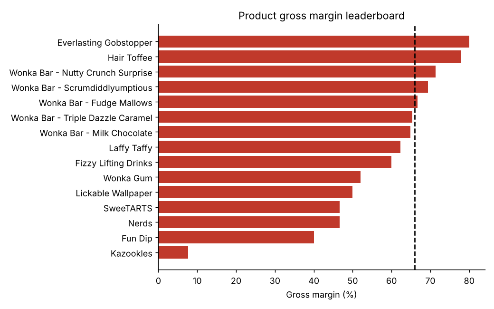
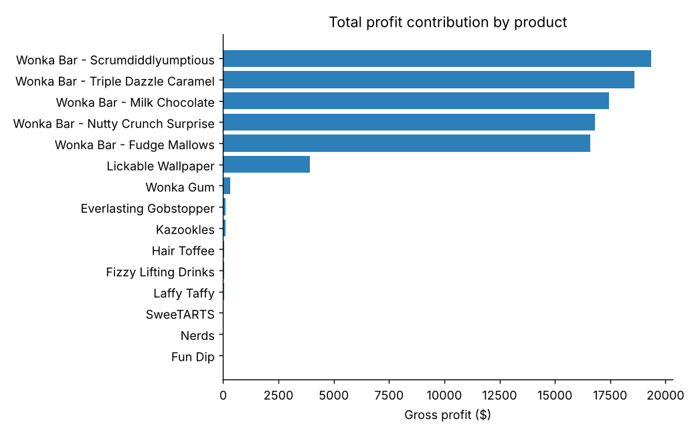
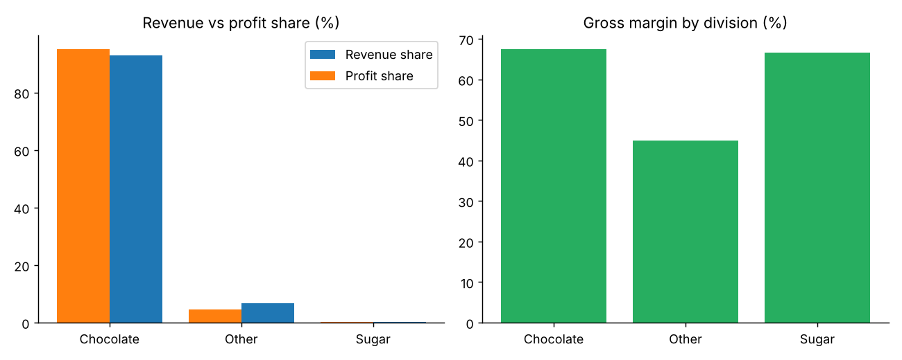
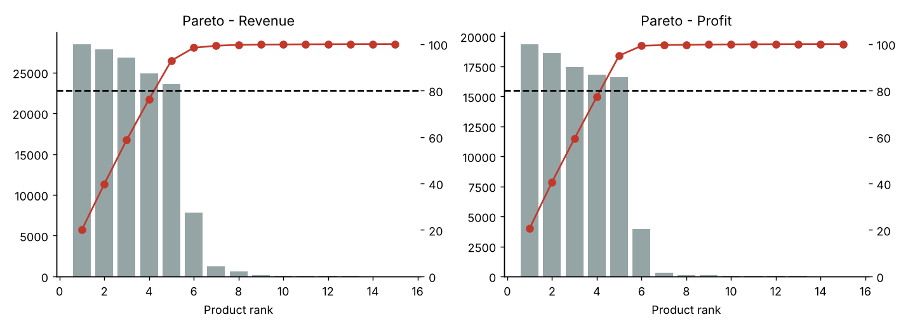
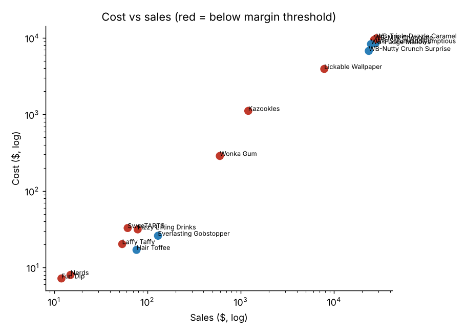
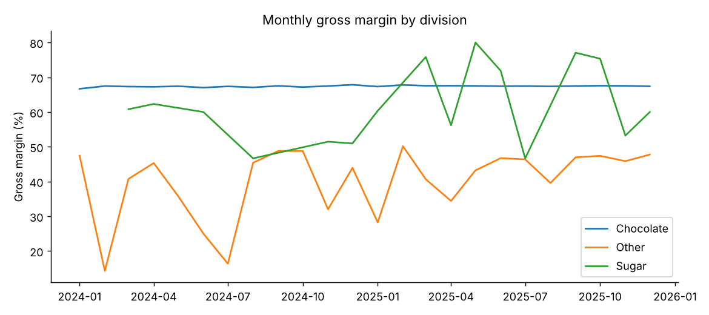

# Product Line Profitability & Margin Performance Analysis for Nassau Candy Distributor

## 1. Introduction
Sales volume alone can hide weak products. This study measures profitability at product, division and factory level, finds where profit is concentrated, and flags products that need repricing, cost renegotiation or review. All numbers come from `data/Nassau_Candy_Distributor.csv` and are reproducible with `python run_analysis.py`.

**Questions:** (1) Which product lines earn the most gross profit and margin? (2) Do high-sales products stay profitable? (3) How does profitability differ across divisions? (4) Where is margin at risk?

## 2. Data and cleaning
10,194 order lines, 2 Jan 2024 – 31 Dec 2025, 15 products, 3 divisions (Chocolate, Sugar, Other), 5 factories. Fields: sales, units, cost and gross profit.

| Check | Result |
|---|---|
| Duplicate Row IDs | 0 |
| Zero/negative sales | 0 |
| Missing or zero units | 0 |
| Gross Profit ≠ Sales − Cost | 0 |
| Product-label fix | "Wonka Bar -Scrumdiddlyumptious" standardised to "Wonka Bar - Scrumdiddlyumptious" |

No rows were removed. The cleaning code (`src/analysis.py`) still handles each case if new data contain them (imputing units from the product's median price, recomputing profit from sales − cost). The `Ship Date` column holds dates in 2026 that follow the order date by about 2.5 years, so it was not used.

## 3. Method
- **Gross margin** = Gross Profit ÷ Sales. **Profit per unit** = Gross Profit ÷ Units.
- **Contribution** = product share of total sales or profit.
- **Margin volatility** = standard deviation of monthly margin (products with fewer than 6 active months are excluded).
- **Segments:** sales above or below the median product; margin above or below the threshold (default: portfolio margin 65.9%).
- **Concentration:** Pareto (80% rule) and the Herfindahl-Hirschman Index (HHI) on profit shares.

## 4. Results

### 4.1 Overall
Sales $141,784; gross profit $93,443; margin 65.9%. 2025 sales were $83.8K versus $58.0K in 2024 (+45%), with margin flat (65.8% → 66.0%).

### 4.2 Product ranking
| Rank | Product | Sales ($) | Gross profit ($) | Margin | Profit/unit |
|---|---|---|---|---|---|
| 1 | Wonka Bar – Scrumdiddlyumptious | 27,875 | 19,358 | 69.4% | 2.50 |
| 2 | Wonka Bar – Triple Dazzle Caramel | 28,485 | 18,610 | 65.3% | 2.45 |
| 3 | Wonka Bar – Milk Chocolate | 26,868 | 17,443 | 64.9% | 2.11 |
| 4 | Wonka Bar – Nutty Crunch Surprise | 23,575 | 16,820 | 71.4% | 2.49 |
| 5 | Wonka Bar – Fudge Mallows | 24,890 | 16,594 | 66.7% | 2.40 |
| 6 | Lickable Wallpaper | 7,860 | 3,930 | 50.0% | 10.00 |
| 7 | Wonka Gum | 598 | 311 | 52.0% | 0.65 |
| 8 | Everlasting Gobstopper | 130 | 104 | 80.0% | 8.00 |
| 9 | Kazookles | 1,206 | 93 | **7.7%** | 0.25 |
| 10–15 | Six other Sugar products | 12–79 each | 5–59 each | 40–78% | 0.60–3.50 |

**Segments.** Stars (high sales, margin at or above average): Scrumdiddlyumptious, Nutty Crunch Surprise, Fudge Mallows. High-sales / low-margin: Triple Dazzle Caramel and Milk Chocolate (only 1–1.5 pp below average), Lickable Wallpaper, Kazookles. Low-sales: all other Sugar products. Gobstopper and Hair Toffee have high margins but only 13 and 17 units sold.

The best profit per unit belongs to Lickable Wallpaper ($10.00) but it sells only 393 units.

### 4.3 Division performance
| Division | Sales share | Profit share | Margin |
|---|---|---|---|
| Chocolate | 92.9% | 95.1% | 67.5% |
| Other | 6.8% | 4.6% | 44.8% |
| Sugar | 0.3% | 0.3% | 66.6% |

Chocolate shows efficient conversion (+2.2 pp profit share over revenue share). "Other" has a structural margin gap (−2.2 pp) driven by Kazookles (7.7%) and Lickable Wallpaper (50%). Sugar's margin looks high but rests on 137 units.

### 4.4 Profit concentration
- 5 of 15 products (33%) supply 80% of revenue and 80% of profit; the top five together supply 92.9% and 95.1%. (Because the five bars are near-equal, the "80%" rule is reached only by taking most of them, so this is concentration in a *group* rather than in one hero product; the top product has 20.7% of profit.)
- Profit HHI is 1,831 (moderate; 1,500–2,500). The top three by factory: Lot's O' Nuts 56.5%, Wicked Choccy's 38.6%, Secret Factory 4.6%.
- By geography profit is spread across regions (Pacific 32.6%, Atlantic 28.9%, Interior 22.8%, Gulf 15.7%) with near-identical margins (65.5–66.4%), but California alone is 19.8% of profit and New York 10.9%.

### 4.5 Cost structure
Unit price and unit cost are effectively fixed per product, so each product's margin is constant over time (volatility = 0). Differences in margin therefore come entirely from price/cost design, not from operations. Cost-to-price ratios: Kazookles 92%; Lickable Wallpaper 50%; Wonka Gum 48%; chocolate bars 29–35%.

Flags (margin threshold = portfolio average 65.9%):
| Flag | Products |
|---|---|
| Discontinuation review | Kazookles |
| Pricing review | Triple Dazzle Caramel, Milk Chocolate, Lickable Wallpaper |
| Low-volume / portfolio review | Wonka Gum, Fizzy Lifting Drinks, Laffy Taffy, SweeTARTS, Nerds, Fun Dip |
| OK | Scrumdiddlyumptious, Nutty Crunch Surprise, Fudge Mallows, Everlasting Gobstopper, Hair Toffee |

## 5. Recommendations
1. **Kazookles:** at $3.25 price and $3.00 cost it earns $0.25 per unit. A price near $6.00 (or cost near $1.63) would give a 50% margin; at current volume a $6.00 price would add about $1.0K profit (≈1% of total). If the market will not bear the price, withdraw it.
2. **Lickable Wallpaper:** a 10% price test would add about $0.8K profit per two years of volume at the same sales.
3. **Triple Dazzle Caramel and Milk Chocolate:** both have higher unit costs ($1.30 and $1.14) than the best bars ($1.00 for Nutty Crunch). A small cost renegotiation at Wicked Choccy's would lift 38.6% of profit.
4. **Sugar:** rationalise the seven low-volume SKUs, or invest in distribution if the division is strategic.
5. **Resilience:** the two chocolate factories carry 95% of profit; develop backup capacity.

## 6. Limitations
Gross margin excludes freight, overhead and promotion cost. Fixed prices prevent elasticity estimates. Two years of data; some products have under 20 orders. Recommendations are a ranking aid, not forecasts.

## 7. Conclusion
Nassau Candy's profit is strong but narrow: five chocolate bars deliver 95%. The clearest margin problem is Kazookles; the clearest upside is modest price and cost work on the "Other" division and the two lowest-margin core bars.

## Appendix – KPI definitions
| KPI | Formula |
|---|---|
| Gross margin % | Gross profit ÷ Sales |
| Profit per unit | Gross profit ÷ Units |
| Revenue contribution | Product sales ÷ Total sales |
| Profit contribution | Product profit ÷ Total profit |
| Margin volatility | Std-dev of monthly margin |
